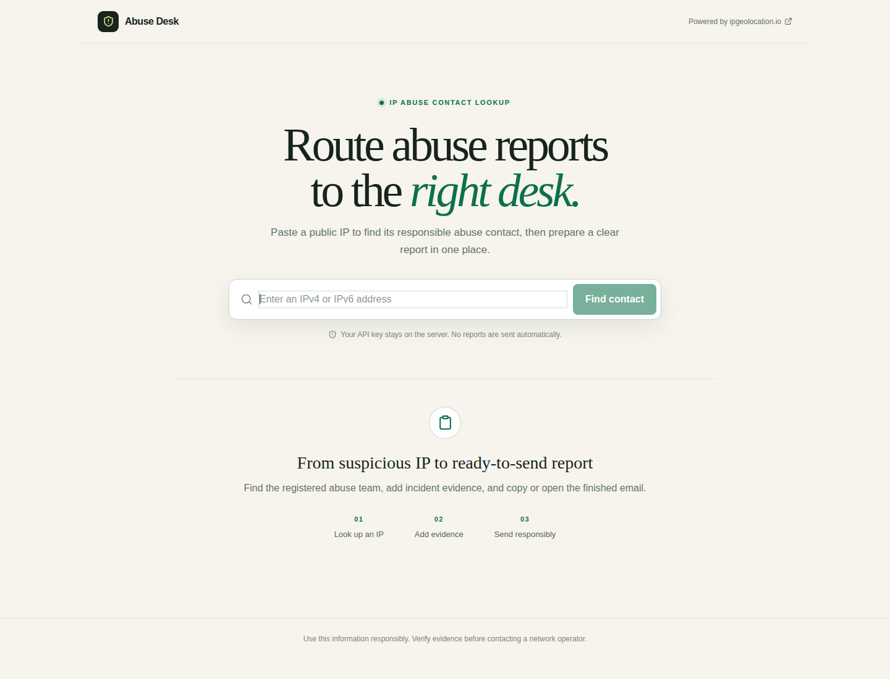

# Abuse Desk Dashboard

A public, open-source tool for finding the abuse contact responsible for an IPv4 or IPv6 address and preparing a clear incident report.

Paste a suspicious public IP address into the dashboard to retrieve its registered abuse desk, contact email, phone number, network range, country, and address. You can then add incident details and either copy the generated report or open it as a prefilled email.

This project is powered by the [IPGeolocation.io IP Abuse Contact API](https://ipgeolocation.io/documentation/ip-abuse-contact-api.html).



## Features

- Look up public IPv4 and IPv6 addresses
- Find the responsible abuse organization or contact role
- View abuse email addresses, phone numbers, registered address, country, and CIDR range
- Classify incidents such as spam, phishing, brute-force attempts, scanning, DDoS, and malware
- Add the observation time and supporting evidence
- Generate a structured abuse-report draft
- Copy the complete report with one click
- Open a prefilled report in the user's default email client
- Keep the IPGeolocation API key on the server
- Responsive interface for desktop and mobile devices

The dashboard does **not** send reports automatically. Users can inspect and edit every report before choosing to send it through their own email client.

## Powered by IPGeolocation.io

The application uses the dedicated IPGeolocation.io API endpoint below:

```text
GET https://api.ipgeolocation.io/v3/abuse
```

The endpoint returns abuse contact information for a public IPv4 or IPv6 address, including:

- Contact or abuse-team name
- Responsible organization
- Contact email addresses
- Phone numbers
- Registered address and country
- Abuse-handling network range in CIDR notation

According to the [IP Abuse Contact API documentation](https://ipgeolocation.io/documentation/ip-abuse-contact-api.html), the dedicated abuse lookup requires an eligible paid subscription and each successful lookup costs one API credit. Check the current [IPGeolocation.io pricing](https://ipgeolocation.io/pricing.html) before deploying the tool publicly.

## Get an IPGeolocation API key

1. Open the [IPGeolocation.io signup page](https://ipgeolocation.io/signup).
2. Create an account or sign in to an existing account.
3. Choose a subscription that includes access to the IP Abuse Contact API.
4. Copy the API key from the IPGeolocation.io dashboard.
5. Add the key to this project's `.env` file:

   ```env
   IPGEOLOCATION_API_KEY=your_api_key_here
   ```

## Run locally

### Requirements

- Node.js 20.9 or newer
- npm
- An IPGeolocation.io API key with access to the IP Abuse Contact API

### Installation

1. Clone the repository:

   ```bash
   git clone https://github.com/Abdullah-Afzal178/abuse-desk-dashboard.git
   cd abuse-desk-dashboard
   ```

2. Install the dependencies:

   ```bash
   npm install
   ```

3. Create a local environment file:

   ```bash
   cp .env.example .env
   ```

4. Open `.env` and replace the placeholder with your API key:

   ```env
   IPGEOLOCATION_API_KEY=your_api_key_here
   ```

5. Start the development server:

   ```bash
   npm run dev
   ```

6. Open [http://localhost:3000](http://localhost:3000) in your browser.

## Production build

Create and run an optimized production build locally:

```bash
npm run build
npm start
```

TypeScript can be checked separately with:

```bash
npm run typecheck
```

## Deploy your own copy

You can deploy this project on any platform that supports Next.js and server-side environment variables.

### Vercel

1. Fork this repository or push your own copy to GitHub.
2. Import the repository into [Vercel](https://vercel.com/new).
3. Add an environment variable named `IPGEOLOCATION_API_KEY`.
4. Set its value to your IPGeolocation.io API key.
5. Deploy the project.

### Other platforms

The same setup works on services such as Netlify, Railway, Render, or a self-hosted Node.js server. Configure `IPGEOLOCATION_API_KEY` as a protected server-side environment variable and use:

```bash
npm run build
npm start
```

Do not expose the API key through a variable prefixed with `NEXT_PUBLIC_`. Those variables are included in browser-side JavaScript.

## How it works

1. The user enters a public IPv4 or IPv6 address.
2. The browser sends the address to the local `/api/abuse` route.
3. The server validates the address before making an upstream request.
4. The server calls the IPGeolocation.io `/v3/abuse` endpoint with the protected API key.
5. The dashboard displays the returned abuse contact information.
6. The user adds incident details and supporting evidence.
7. The dashboard creates a report that can be copied or opened in an email client.

Private, reserved, malformed, or unavailable IP addresses are rejected with an explanatory error.

## Project structure

```text
abuse-desk-dashboard/
├── app/
│   ├── api/abuse/route.ts   # Server-side IPGeolocation.io proxy
│   ├── globals.css          # Global styles and responsive layout
│   ├── layout.tsx           # Root layout and metadata
│   └── page.tsx             # Main page
├── components/
│   └── abuse-desk.tsx       # Lookup interface and report builder
├── .env.example             # Required environment-variable template
├── next.config.ts           # Next.js configuration
├── package.json             # Scripts and dependencies
└── tsconfig.json            # TypeScript configuration
```

## Security and responsible use

- The API key is used only by the server route and is not returned to the browser.
- Lookup responses are not stored in a database by this project.
- Reports are generated locally in the browser and are not submitted automatically.
- Review the IP address, evidence, recipient, and report text before sending anything.
- Remove passwords, authentication tokens, unnecessary personal information, and unrelated log data from evidence.
- Do not use the tool for harassment, false reports, or automated mass reporting.
- Public deployments should add rate limiting or access controls appropriate to their expected traffic to protect the API quota.

## API errors

The dashboard presents errors returned by IPGeolocation.io. Common causes include:

- Invalid IPv4 or IPv6 input
- Private, reserved, or bogon IP ranges
- Missing or invalid API key
- A subscription without access to the Abuse Contact API
- Exhausted API credits or rate limits
- An address that is not available in the provider's database

Refer to the [official IP Abuse Contact API documentation](https://ipgeolocation.io/documentation/ip-abuse-contact-api.html) for current response fields, credit usage, and error codes.

## Contributing

Issues and pull requests are welcome. If you make a functional change, run the following checks before opening a pull request:

```bash
npm run typecheck
npm run build
```

## Acknowledgements

- [IPGeolocation.io](https://ipgeolocation.io) for the IP Abuse Contact API
- [Next.js](https://nextjs.org) and [React](https://react.dev) for the application framework
- [Tailwind CSS](https://tailwindcss.com) for the styling toolchain
- [Lucide](https://lucide.dev) for the interface icons

---

Built with the [IPGeolocation.io IP Abuse Contact API](https://ipgeolocation.io/documentation/ip-abuse-contact-api.html).
